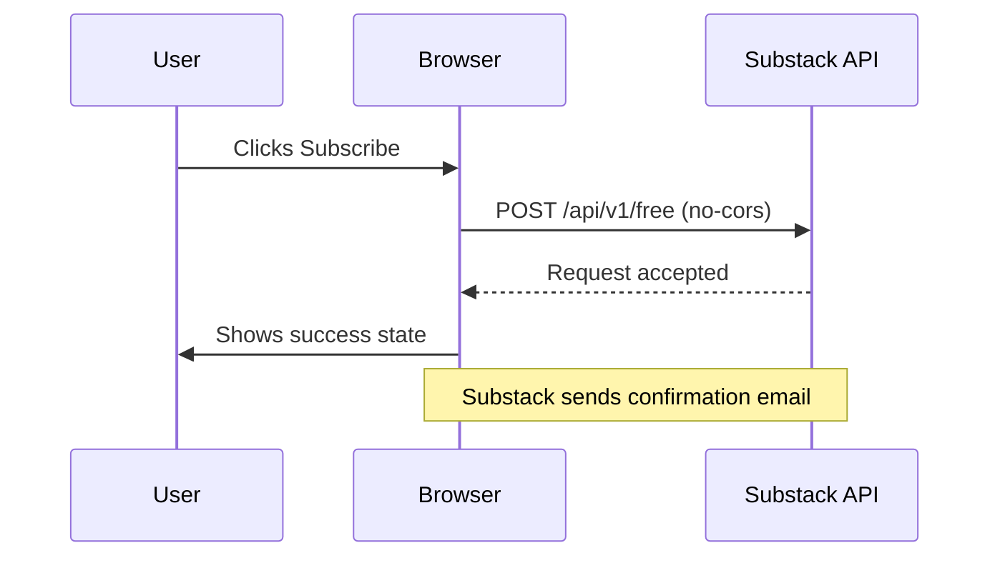

# Substack Direct Subscribe

A lightweight, client-side integration for collecting email subscriptions directly to your Substack publication — no server required.

The form sends requests **directly from the user's browser** to Substack's API using `no-cors` mode, bypassing the cloud-IP blocks that prevent server-side requests. This means no backend, no webhooks, no proxy — just your site and Substack.

## Why this approach

Substack blocks API requests from cloud/ datacenter IPs (Vercel, Netlify, Cloudflare, AWS, etc.). Standard server-side POSTs fail silently. This solution:

- Sends the subscribe request **from the visitor's browser** (a real user IP)
- Uses `fetch` with `mode: 'no-cors'` to work around Substack's CORS policy
- Requires zero server infrastructure

## What's included

| Component | Description |
|-----------|-------------|
| `SubstackForm` | Email input + submit button with idle, submitting, success, and error states |
| `SubstackPopup` | Timed modal popup that auto-appears after a configurable delay |

## Installation

### React / Next.js

```bash
npm install substack-direct-subscribe
```

Or copy `src/SubstackForm.tsx` and `src/SubstackPopup.tsx` directly into your project.

### Static HTML

Copy the demo at `demo/index.html` as a starting point.

## Usage

### Basic form

```tsx
import { SubstackForm } from "substack-direct-subscribe";

<SubstackForm
  substackUrl="https://yourpub.substack.com"
  publicationId="123456"
/>
```

### Popup (appears after a delay)

```tsx
import { SubstackPopup } from "substack-direct-subscribe";

<SubstackPopup
  substackUrl="https://yourpub.substack.com"
  publicationId="123456"
  delayMinutes={3}
/>
```

### Programmatic popup trigger

Dispatch a `open-newsletter-popup` event from anywhere in your app:

```tsx
<button onClick={() => window.dispatchEvent(new CustomEvent("open-newsletter-popup"))}>
  Subscribe
</button>
```

## Props

### SubstackForm

| Prop | Type | Default | Description |
|------|------|---------|-------------|
| `substackUrl` | `string` | required | Your Substack publication URL |
| `publicationId` | `string` | required | Your Substack publication ID |
| `layout` | `"card" \| "banner"` | `"card"` | Visual variant |
| `fullWidth` | `boolean` | `false` | Expand input to full width |
| `align` | `"left" \| "center" \| "right"` | `"center"` | Form alignment |
| `onSuccess` | `() => void` | — | Callback after successful submission |

### SubstackPopup

| Prop | Type | Default | Description |
|------|------|---------|-------------|
| `substackUrl` | `string` | required | Your Substack publication URL |
| `publicationId` | `string` | required | Your Substack publication ID |
| `delayMinutes` | `number` | `5` | Minutes before popup appears |
| `onSubscribe` | `() => void` | — | Called after subscription |

## Finding your publication ID

1. Go to your Substack dashboard
2. Open browser DevTools → Network tab
3. Sign up a test email on your Substack site
4. Look for the POST request to `/api/v1/free`
5. The `landingPublicationId` field contains your publication ID

Alternatively, inspect the subscribe button on your Substack site — the data attribute often contains it.

## How it works



The form sends:
- `email` — the subscriber's email
- `first_url` / `current_url` — where the subscription happened
- `landingPublicationId` — your publication ID

Substack processes the subscription and sends a confirmation email. No server, no proxy, no backend.

## Styling

The components use Tailwind CSS classes. If you're not using Tailwind, override styles via the `className` prop or copy the components and replace the classes with your own.

## License

MIT
